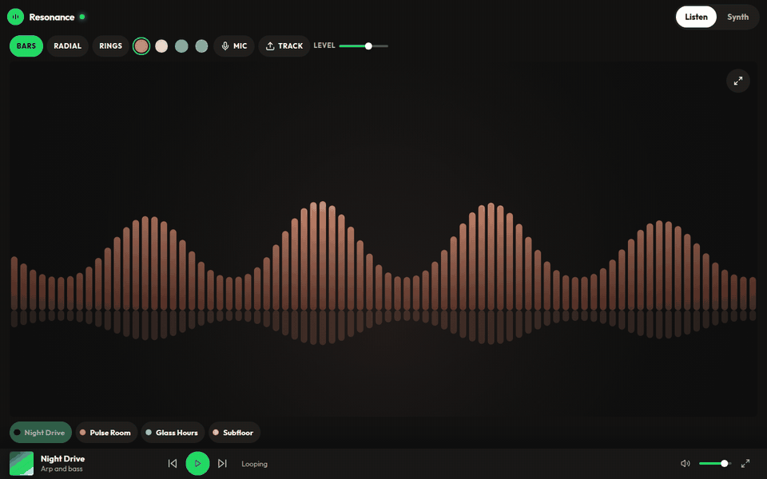

# Resonance



A music visualizer and synthesizer that runs in the browser.

Live demo: https://resonance-delta-three.vercel.app

## Run it

```bash
npm install && npm run dev
```

Then open http://localhost:8080. Audio starts after a click or a key press.

## Listen

The stage follows the microphone, an uploaded track, or a built-in loop.

- Bars, radial, and rings
- Copper, Paper, Tide, and Dusk color themes
- Sensitivity, play and pause, skip, seek, volume, and fullscreen
- Drag a track onto the stage, or pick one with Track

## Synth

Play from the on-screen keys or the computer keyboard. White keys start at A, and the black keys sit on the row above.

- Sine, triangle, saw, and square
- Filter, resonance, and an ADSR envelope
- Octave shift, volume, oscilloscope, and level meter
- Presets, including one you can save on this device

## Checks

```bash
npm run lint
npm run typecheck
npm run build
```

GitHub Actions runs those three on every pull request. `npm test` covers helper scripts. A few of them look for local tooling files that are not in the git checkout, so a failure there is not always a problem in the app.

## License

MIT. See [LICENSE](LICENSE).
